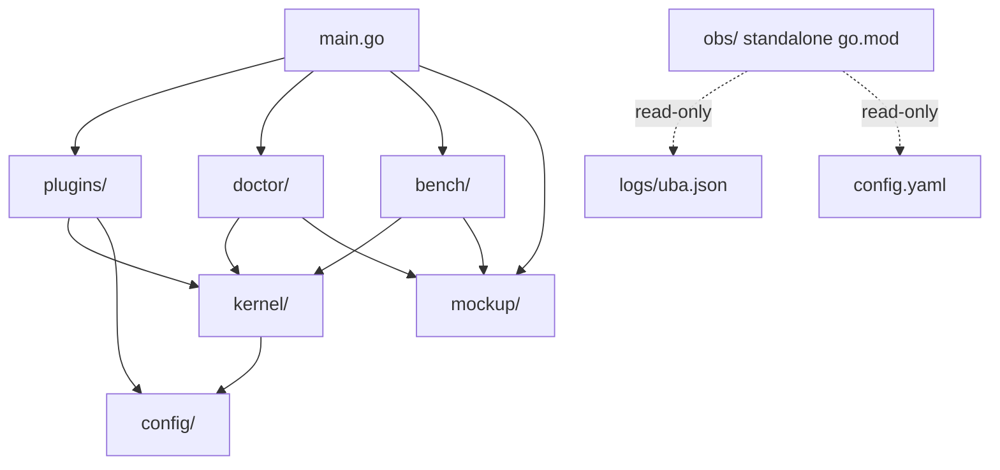
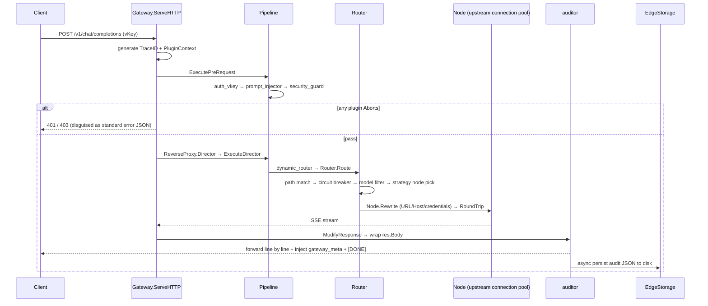

# AI-Gateway-Core Architecture
**English** | [中文](architecture.md)

> For contributors and secondary developers. This document describes the complete architecture of the v0.1 kernel: layered structure, request lifecycle, module responsibilities, plugin mechanism, routing engine, and concurrency-safety design.

---

## 1. Design Philosophy

- **Zero external dependencies**: only the Go standard library `net/http` + `net/http/httputil.ReverseProxy`, with no third-party modules whatsoever.
- **Declarative, configuration-driven (GitOps)**: no admin console is built and no external database is relied upon; all behavior is declared in `config.yaml`, loaded in a typed manner at startup, and statically audited.
- **Kernel decoupled from plugins**: `kernel/` does not depend on `plugins/`; plugins register through interfaces and can be added or removed independently without affecting the kernel.
- **Uninterrupted hot reload**: the runtime holds an immutable snapshot; when the configuration changes, everything is rebuilt and atomically swapped inside the write lock, while readers share it lock-free.
- **Backward compatibility**: plugin interfaces carry a version number, `BasePlugin` supplies empty implementations as a fallback, and adding methods in the future will not break existing plugins.

---

## 2. Layered Architecture

```
┌────────────────────────────────────────────────────────────────────────────────┐
│                              Entry Layer main.go                               │
│  serve (gateway) │ check / doctor (diagnostics) │ bench (load test)            │
└───────────────┬────────────────────────────────────────────────────────────────┘
                │ blank import _ "plugins" triggers init registration of each plugin
┌───────────────▼────────────────────────────────────────────────────────────────┐
│               Plugin Layer plugins/ (standard intercept plugins)               │
│  auth_vkey → prompt_injector → security_guard (PreRequest chain)               │
│  dynamic_router (Director stage) → auditor (ModifyResponse stage)              │
└──────┬───────────────────────┬─────────────────────────────────────────────────┘
       │ implements Plugin     │ reads/writes request data via PluginContext
┌──────▼───────────────────────▼─────────────────────────────────────────────────┐
│               Kernel Layer kernel/ (does not depend on plugins)                │
│  Gateway orchestration + hot reload                                            │
│  Pipeline plugin chain / Router routing engine / ReverseProxy                  │
│  Node (connection pool + circuit breaker + EMA) / PluginContext / BufferPool   │
│  EdgeStorage edge persist to disk / Watchdog                                   │
└──────┬──────────────────────────────┬──────────────────────────────────────────┘
       │ typed load + Validate        │ async output uba.json (audit)
┌──────▼──────────────────────────────▼──────────────────────────────────────────┐
│  Config Layer config/ (hand-written YAML subset parser)                        │
│  Observability Layer obs/ (read-only web console)                              │
└────────────────────────────────────────────────────────────────────────────────┘
```

Dependency direction (unidirectional):



`obs/` is a standalone Go module that reads `logs/uba.json` and `config.yaml` read-only and does not depend back on any gateway code.

---

## 3. Request Lifecycle

```
Client
  │  POST /v1/chat/completions
  │  Authorization: Bearer <vKey>
  │  Content-Type: application/json
  ▼
Gateway.ServeHTTP
  ├─ ① Snapshot read (RLock, lock-free sharing of the immutable runtimeSnapshot)
  ├─ ② Generate a 128bit TraceID, create the PluginContext (RWMutex-protected Scratchpad)
  ├─ ③ PluginContext injection: config / router / storage references
  ▼
Pipeline.ExecutePreRequest  ── PreRequest plugin chain (sorted by config order)
  ├─ auth_vkey       extract Bearer → O(1) Map auth → inject identity/department/allowlist/tags
  │                  (HAL hardware fingerprint reserved, gracefully skipped on Mac)
  ├─ prompt_injector parse JSON Body → department template injection → io.NopCloser rewrites Body
  │                  records model / original_prompt / final_prompt / token estimate
  └─ security_guard  sensitive-word DLP + anti-injection regex → on hit, disguised as a standard 403
  │   (any plugin Abort → writeAbort returns directly without proxying; PreRequest error → 502)
  ▼
httputil.ReverseProxy ── proxy stage
  ├─ Director:      Pipeline.ExecuteDirector → dynamic_router.Director
  │                 → Router.Route:
  │                    exact path match → circuit breaker filter → hard model constraint filter
  │                    → Strategy.Select picks a node
  │                    → Node.Rewrite (rewrite URL/Host + credential substitution)
  ├─ Transport:     routerRoundTripper → Node.RoundTrip
  │                 circuit breaker admission → dedicated connection pool → connection count/latency EMA/TTFT recording
  └─ ModifyResponse: Pipeline.ExecuteModifyResponse → auditor
                     SSE line-by-line streaming interception / non-streaming JSON buffered audit
  ▼
Client ← streaming response
          injects data: {"gateway_meta":{trace_id, executed_plugins,
                                                total_tokens, prompt_injected}} before [DONE]
          injects response headers X-AI-Gateway-Trace-ID / X-AI-Gateway-Executed-Plugins
          async Goroutine → stdout + EdgeStorage (uba.json, FIFO rotation)
```



---

## 4. Module Responsibilities

### 4.1 kernel/ (kernel, does not depend on plugins)

| File | Responsibility | Key mechanisms |
|---|---|---|
| `gateway.go` | Top-level orchestrator | `runtimeSnapshot` (cfg+pipeline+router+proxy) immutable snapshot; global RWMutex; the `HotReload` background goroutine polls the file mtime every 2s and runs `rebuild` to atomically swap on change; `Shutdown` graceful shutdown |
| `pipeline.go` | Plugin chain executor | `pluginRegistry` (PluginFactory registry); `BuildPipeline` sorts by order and binds fail_strategy; three-stage executor (PreRequest / Director / ModifyResponse); `RegisterDynamicPlugin` dynamic mount slot |
| `context.go` | Request-scoped Scratchpad | RWMutex-protected `map[string]any`; the `gw_` namespace is reserved to avoid collisions with plugin keys; `NewTraceID` (crypto/rand 128bit); Abort triple marker |
| `plugin.go` | Plugin interface definitions | `Plugin` (Name/ApiVersion/Init/PreRequest/ModifyResponse) + `BasePlugin` empty implementation + optional `DirectorHook` interface + `FailStrategy` (abort/bypass) |
| `router.go` | Multi-dimensional routing engine | `RoutingStrategy` strategy factory (5 kinds); `RouteRule` (path → strategy → node group); `NodeRuntime`, state that persists across hot reloads (circuit breaker/EMA/connection count); `Node.RoundTrip` statistics instrumentation; `Node.Rewrite` (URL/Host/credentials); Baidu `ensureAccessToken` credential-exchange cache |
| `circuit.go` | State-machine circuit breaker | closed/open/half_open three states (atomic); opens when consecutive failures reach the threshold; periodic half_open probes are admitted; `JitterBackoff` exponential backoff + random jitter |
| `proxy.go` | Reverse proxy | `NewReverseProxy` binds Director/Transport/ModifyResponse/ErrorHandler; `FlushInterval=-1` synchronous backpressure; `routerRoundTripper` takes the node from req.Context and dispatches; `NewTransport` locks down connect/TTFT/idle-read timeouts |
| `buffer.go` | Global byte pool | `sync.Pool` of fixed 32KB slices; implements `httputil.BufferPool`; `ReadBody` pooled relay read; `Put` validates size to prevent pool pollution |
| `storage.go` | Edge ring persist to disk | Append-writes `uba.json`; FIFO rotation on threshold (overwrites `.1`); 4096-capacity async report queue (when full, drop the remote copy and keep the local one); JitterBackoff retries on failure |
| `watchdog.go` | Hardware watchdog | Periodically feeds `/dev/watchdog`; gracefully skipped on Mac where the device is absent; log path adapts to the environment (Mac→`./logs/uba.json`, Linux→`/var/log/ai-gateway/uba.json`) |

### 4.2 config/ (configuration layer)

- `yaml.go`: hand-written zero-dependency YAML subset parser (map/array/scalar; advanced syntax such as anchors and aliases is not supported).
- `config.go`: typed `Config` struct + `buildConfig` constructing from the parse tree + `Validate` static audit (port / non-empty secrets / upstream naming and protocol / route paths and references / plugin order conflicts / positive timeouts).

### 4.3 plugins/ (standard intercept plugins, see [plugins.md](./plugins.en.md) for details)

| Plugin | Registered name | Stage | One-line responsibility |
|---|---|---|---|
| vKey auth | `auth_vkey` | PreRequest | Bearer vKey O(1) Map auth + identity injection + HAL fingerprint reserved |
| Prompt injection | `prompt_injector` | PreRequest | Injects enterprise guideline templates per department + hard model allowlist constraint |
| Security guard | `security_guard` | PreRequest | Sensitive-word DLP + prompt-injection defense; on hit, disguised 403 |
| Dynamic routing | `dynamic_router` | Director | Calls `Router.Route` to pick a node and rewrite the request |
| Streaming audit | `auditor` | ModifyResponse | SSE non-blocking streaming interception + official billing override + audit persist to disk |

### 4.4 Tooling and Observability

| Module | Description |
|---|---|
| `doctor/` (check subcommand) | Static config audit + upstream connectivity/key probing + in-memory sandbox dry run (normal/violation cases) + topology visualization |
| `bench/` (bench subcommand) | Concurrent load-testing engine: QPS / success rate / 403 interception rate / P50-P99 / memory growth / connection leakage |
| `mockup/` | In-memory mock streaming upstream (OpenAI-compatible SSE + cached_tokens usage), powering doctor/bench and the `serve -mock` closed loop |
| `obs/` | Read-only observability console in a standalone module: summary cards / cost distribution / audit table / call-chain timeline |

---

## 5. Routing Engine

### 5.1 Three-level filtering + strategy selection

```
Request path ──exact match──▶ RouteRule
                              │
                    circuitAllowed filter (drop nodes whose circuit breaker is open)
                              │
                    modelAllowed filter (hard model constraint: no upstream support → 400
                    no upstream supports model)
                              │
                    Strategy.Select picks the best node
                              │
                    Node.Rewrite (URL/Host/credentials) → node attached to req.Context
```

### 5.2 Five strategies

| Strategy | Selection | Notes |
|---|---|---|
| `round_robin` | atomic counter modulo | fallback strategy |
| `least_connection` | fewest active connections, ties broken by round robin | the connection count is reclaimed by `nodeBody` when the stream closes |
| `latency` | smallest latency EMA, ties broken by round robin | **unmeasured nodes are never preferred**, avoiding a cold-start avalanche |
| `cost` | lowest `cost_per_1k`, ties broken by round robin | static rate |
| `domain_tag` | score by the intersection of user tags × upstream tags | degrades to round robin when the score is 0 |

> Note: the `routers[].domain_tags` declared in routing rules are currently only parsed and take no part in matching; actual matching is based on `auth.keys[].tags` × `upstreams[].tags` (see the known limitations in the README).

### 5.3 Node runtime state (NodeRuntime)

`NodeRuntime` hangs off the `Gateway.runtimes` map and **persists across hot reloads**: when a configuration refresh rebuilds a `Node`, the same `NodeRuntime` is reused, so circuit breaker state, latency/first-token EMA, and connection counts do not reset on refresh.

---

## 6. Concurrency Safety and Performance Design

```
┌─ Hot reload: the whole snapshot is rebuilt inside the write lock and atomically swapped, while readers share it lock-free under RLock ─┐
├─ Context: PluginContext RWMutex, eradicating concurrent map races ─────────────────────────────────────────────────────────────────────│
├─ Zero-copy: a sync.Pool 32KB pool spans request relay / body rewrite / streaming parsing ──────────────────────────────────────────────│
├─ Backpressure: FlushInterval=-1 forwards synchronously, so slow clients back-pressure the upstream, with no unbounded buffering ───────│
├─ Timeouts: connect 5s / TTFT first token 10s / streaming idle read 30s (504) ──────────────────────────────────────────────────────────│
├─ Circuit break: 5 consecutive failures open the breaker; after 30s half_open admits 3 probes ──────────────────────────────────────────│
├─ Backoff: JitterBackoff (exponential ×2 + random jitter, capped at 1min) ──────────────────────────────────────────────────────────────│
└─ Reclaim: nodeBody once guarantees connection counts/EMA are reclaimed exactly once ───────────────────────────────────────────────────┘
```

---

## 7. Audit Data Flow

```
auditor (ModifyResponse)
  ├─ SSE: streamInterceptor parses line by line (never reads the whole body into memory)
  │       captures usage.prompt_tokens_details.cached_tokens → official billing override
  │       EOF without [DONE] → append an error chunk + [DONE] (prevents downstream deadlock)
  │       injects the gateway_meta chunk before [DONE]
  ├─ JSON: jsonAuditBody buffers and parses usage
  ▼
async Goroutine (emitAudit)
  ├─ echo to stdout (can be disabled during bench load tests via plugins.SetAuditStdout(false))
  └─ EdgeStorage.Append
       ├─ local append to logs/uba.json (FIFO rotation to .1 after max_disk_mb is reached)
       └─ non-blocking enqueue → reportLoop async POST report_url (JitterBackoff retries)
```

The audit record field definitions are in [audit-log.md](./audit-log.md).

---

## 8. Directory Structure

```
ai-gateway-core/
├── main.go                 # entry point: serve / check / bench subcommands
├── config.yaml             # declarative configuration (GitOps single source of truth, gitignored)
├── config.example.yaml     # configuration example (shipped with the repo, secrets via environment variables)
├── go.mod                  # module ai-gateway-core · go 1.23 · zero dependencies
├── config/                 # hand-written YAML subset parsing + typed load + Validate
├── kernel/                 # kernel (does not depend on plugins): gateway/pipeline/plugin/
│                           #   context/router/circuit/proxy/buffer/storage/watchdog
├── plugins/                # standard intercept plugins: auth_vkey/injector/security_guard/
│                           #   dynamic_router/auditor + util (token estimation, etc.)
├── doctor/                 # check subcommand (diagnostics engine)
├── bench/                  # bench subcommand (load-testing engine)
├── mockup/                 # in-memory mock streaming upstream
├── obs/                    # read-only observability console (standalone go.mod, reads uba.json + config.yaml)
├── docs/                   # directory containing this document
└── logs/uba.json           # audit log generated at runtime (JSON-lines)
```
