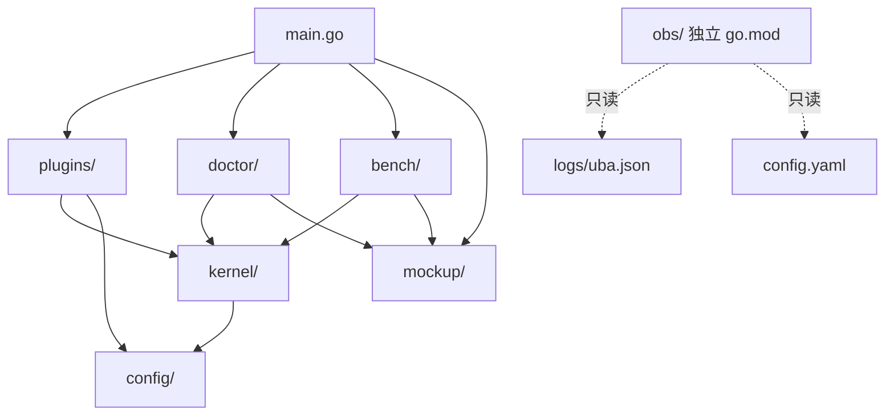
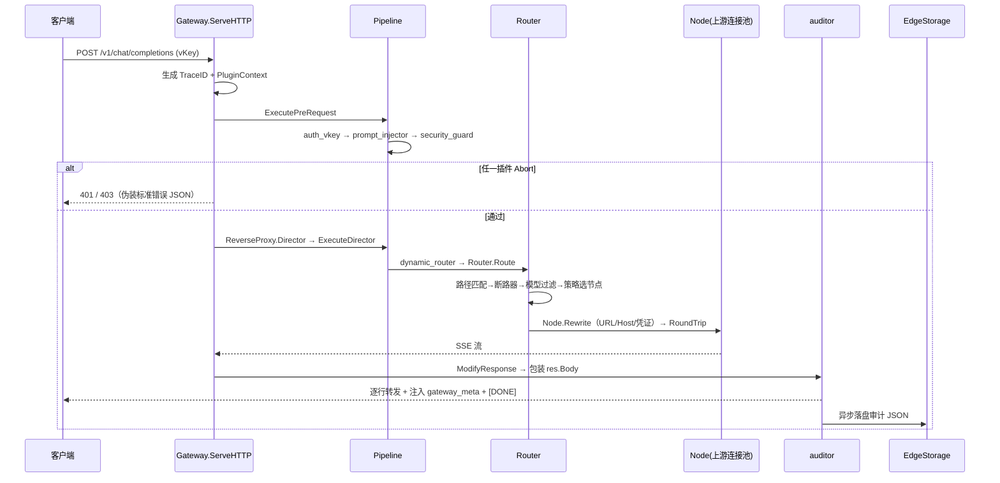

# AI-Gateway-Core 架构说明

> 面向贡献者与二次开发者。本文档描述 v0.1 内核的完整架构：分层结构、请求生命周期、模块职责、插件机制、路由引擎与并发安全设计。

---

## 1. 设计哲学

- **零外部依赖**：仅 Go 标准库 `net/http` + `net/http/httputil.ReverseProxy`，无任何第三方模块。
- **声明式配置驱动（GitOps）**：不开发管理端、不依赖外部数据库，一切行为由 `config.yaml` 声明，启动时类型化加载 + 静态审计。
- **内核与插件解耦**：`kernel/` 不依赖 `plugins/`，插件通过接口注册，可独立增删，不影响内核。
- **热加载无中断**：运行时持有不可变快照，配置变更时整体重建并在写锁内原子交换，读侧无锁共享。
- **向后兼容**：插件接口带版本号，`BasePlugin` 空实现兜底，未来加方法不破坏既有插件。

---

## 2. 分层架构

```
┌───────────────────────────────────────────────────────────────────┐
│                        入口层 main.go                              │
│   serve（网关）│ check / doctor（诊断）│ bench（压测）             │
└───────────────┬───────────────────────────────────────────────────┘
                │ 空导入 _ "plugins" 触发各插件 init 注册
┌───────────────▼───────────────────────────────────────────────────┐
│                      插件层 plugins/（标准拦截插件）               │
│   auth_vkey → prompt_injector → security_guard（PreRequest 链）   │
│   dynamic_router（Director 阶段）→ auditor（ModifyResponse 阶段）  │
└──────┬───────────────────────┬────────────────────────────────────┘
       │ 实现 Plugin 接口       │ 通过 PluginContext 读写请求数据
┌──────▼───────────────────────▼────────────────────────────────────┐
│                      内核层 kernel/（不依赖 plugins）              │
│  Gateway 编排 + 热加载                                           │
│  Pipeline 插件链 / Router 路由引擎 / ReverseProxy 反向代理        │
│  Node（连接池+断路器+EMA）/ PluginContext / BufferPool            │
│  EdgeStorage 边缘落盘 / Watchdog 看门狗                          │
└──────┬──────────────────────────────┬─────────────────────────────┘
       │ 类型化加载 + Validate         │ 异步输出 uba.json（审计）
┌──────▼──────────────────────────────▼─────────────────────────────┐
│  配置层 config/（手写 YAML 子集解析）   观测层 obs/（只读网页）    │
└───────────────────────────────────────────────────────────────────┘
```

依赖方向（单向）：



`obs/` 是独立 Go module，只读 `logs/uba.json` 与 `config.yaml`，不反向依赖网关任何代码。

---

## 3. 请求生命周期

```
客户端
  │  POST /v1/chat/completions
  │  Authorization: Bearer <vKey>
  │  Content-Type: application/json
  ▼
Gateway.ServeHTTP
  ├─ ① 快照读取（RLock，无锁共享不可变 runtimeSnapshot）
  ├─ ② 生成 128bit TraceID，创建 PluginContext（RWMutex 保护的 Scratchpad）
  ├─ ③ PluginContext 注入：config / router / storage 引用
  ▼
Pipeline.ExecutePreRequest  ── PreRequest 插件链（按 config 的 order 排序）
  ├─ auth_vkey       提取 Bearer → O(1) Map 鉴权 → 注入身份/部门/白名单/tags
  │                  （HAL 硬件指纹预留，Mac 优雅跳过）
  ├─ prompt_injector 解析 JSON Body → 部门模板注入 → io.NopCloser 重写 Body
  │                  记录 model / original_prompt / final_prompt / token 预估
  └─ security_guard  敏感词 DLP + 防注入正则 → 命中即伪装标准 403
  │   （任一插件 Abort → writeAbort 直接返回，不再代理；PreRequest 错误 → 502）
  ▼
httputil.ReverseProxy ── 代理阶段
  ├─ Director:      Pipeline.ExecuteDirector → dynamic_router.Director
  │                 → Router.Route：
  │                    路径精确匹配 → 断路器过滤 → 模型强约束过滤 → 策略挑节点
  │                    → Node.Rewrite（重写 URL/Host + 凭证替换）
  ├─ Transport:     routerRoundTripper → Node.RoundTrip
  │                 断路器放行 → 独立连接池 → 连接计数/延迟EMA/TTFT 记录
  └─ ModifyResponse: Pipeline.ExecuteModifyResponse → auditor
                     SSE 逐行流式拦截 / 非流式 JSON 缓冲审计
  ▼
客户端 ← 流式响应
          [DONE] 前注入 data: {"gateway_meta":{trace_id, executed_plugins,
                                                total_tokens, prompt_injected}}
          响应头注入 X-AI-Gateway-Trace-ID / X-AI-Gateway-Executed-Plugins
          异步 Goroutine → stdout + EdgeStorage（uba.json，FIFO 轮转）
```



---

## 4. 模块职责

### 4.1 kernel/（内核，不依赖 plugins）

| 文件 | 职责 | 关键机制 |
|---|---|---|
| `gateway.go` | 顶层编排器 | `runtimeSnapshot`（cfg+pipeline+router+proxy）不可变快照；全局 RWMutex；`HotReload` 后台协程 2s 轮询文件 mtime，变更即 `rebuild` 原子交换；`Shutdown` 优雅停机 |
| `pipeline.go` | 插件链执行器 | `pluginRegistry`（PluginFactory 注册表）；`BuildPipeline` 按 order 排序 + fail_strategy 绑定；三阶段执行器（PreRequest / Director / ModifyResponse）；`RegisterDynamicPlugin` 动态挂载槽位 |
| `context.go` | 请求级 Scratchpad | RWMutex 保护的 `map[string]any`；`gw_` 命名空间锁死避免与插件键冲突；`NewTraceID`（crypto/rand 128bit）；Abort 三元组标记 |
| `plugin.go` | 插件接口定义 | `Plugin`（Name/ApiVersion/Init/PreRequest/ModifyResponse）+ `BasePlugin` 空实现 + `DirectorHook` 可选接口 + `FailStrategy`（abort/bypass） |
| `router.go` | 多维路由引擎 | `RoutingStrategy` 策略工厂（5 种）；`RouteRule`（路径→策略→节点组）；`NodeRuntime` 跨热加载持久状态（断路器/EMA/连接计数）；`Node.RoundTrip` 统计打点；`Node.Rewrite`（URL/Host/凭证）；百度 `ensureAccessToken` 换钥缓存 |
| `circuit.go` | 状态机断路器 | closed/open/half_open 三态（atomic）；连续失败达阈值开闸；定时 half_open 探测放行；`JitterBackoff` 指数退避 + 随机抖动 |
| `proxy.go` | 反向代理 | `NewReverseProxy` 绑定 Director/Transport/ModifyResponse/ErrorHandler；`FlushInterval=-1` 同步背压；`routerRoundTripper` 从 req.Context 取节点分发；`NewTransport` 锁死建连/TTFT/空闲读超时 |
| `buffer.go` | 全局字节池 | `sync.Pool` 固定 32KB 切片；实现 `httputil.BufferPool`；`ReadBody` 池化中转读取；`Put` 校验尺寸防污染 |
| `storage.go` | 边缘环形落盘 | 追加写 `uba.json`；达阈值 FIFO 轮转（`.1` 覆盖）；4096 容量异步上报队列（满则丢远端保本地）；失败 JitterBackoff 重试 |
| `watchdog.go` | 硬件看门狗 | 周期向 `/dev/watchdog` 喂狗；Mac 无设备优雅跳过；日志路径环境自适应（Mac→`./logs/uba.json`，Linux→`/var/log/ai-gateway/uba.json`） |

### 4.2 config/（配置层）

- `yaml.go`：手写零依赖 YAML 子集解析器（map/array/scalar，不支持锚点别名等高级语法）。
- `config.go`：类型化 `Config` 结构 + `buildConfig` 从解析树构建 + `Validate` 静态审计（端口/密钥非空/上游命名与协议/路由路径与引用/插件顺序冲突/超时为正）。

### 4.3 plugins/（标准拦截插件，详见 [plugins.md](./plugins.md)）

| 插件 | 注册名 | 阶段 | 一句话职责 |
|---|---|---|---|
| vKey 鉴权 | `auth_vkey` | PreRequest | Bearer vKey O(1) Map 鉴权 + 身份注入 + HAL 指纹预留 |
| 提示词注入 | `prompt_injector` | PreRequest | 按部门注入企业准则模板 + 模型白名单强约束 |
| 安全防护 | `security_guard` | PreRequest | 敏感词 DLP + 防提示词注入，命中伪装 403 |
| 动态路由 | `dynamic_router` | Director | 调 `Router.Route` 选节点并重写请求 |
| 流式审计 | `auditor` | ModifyResponse | SSE 非阻塞流式拦截 + 官方计费覆盖 + 审计落盘 |

### 4.4 工具与观测

| 模块 | 说明 |
|---|---|
| `doctor/`（check 子命令） | 配置静态审计 + 上游连通/密钥探测 + 内存沙箱干跑（正常/违规用例）+ 拓扑可视化 |
| `bench/`（bench 子命令） | 并发压测引擎：QPS/成功率/403 拦截率/P50-P99/内存膨胀/连接残留 |
| `mockup/` | 内存 Mock 流式上游（OpenAI 兼容 SSE + cached_tokens usage），供 doctor/bench 与 `serve -mock` 闭环 |
| `obs/` | 独立 module 的只读观测台：汇总卡/成本分布/审计表/调用链时间线 |

---

## 5. 路由引擎

### 5.1 三级过滤 + 策略挑选

```
请求路径 ──精确匹配──▶ RouteRule
                        │
              circuitAllowed 过滤（断路器开启的节点剔除）
                        │
              modelAllowed 过滤（模型强约束：无上游支持 → 400
              no upstream supports model）
                        │
              Strategy.Select 挑选最佳节点
                        │
              Node.Rewrite（URL/Host/凭证）→ 节点挂入 req.Context
```

### 5.2 五种策略

| 策略 | 挑法 | 备注 |
|---|---|---|
| `round_robin` | 原子计数器取模 | 兜底策略 |
| `least_connection` | 最少活跃连接，平手轮询 | 连接数由 `nodeBody` 在流关闭时回收 |
| `latency` | 延迟 EMA 最小，平手轮询 | **未测量节点不当首选**，避免冷启动雪崩 |
| `cost` | `cost_per_1k` 最低，平手轮询 | 静态费率 |
| `domain_tag` | 用户 tags × 上游 tags 交集打分 | 得分 0 时退化为轮询 |

> 注：路由规则里声明的 `routers[].domain_tags` 当前仅解析未参与匹配，实际匹配依据是 `auth.keys[].tags` × `upstreams[].tags`（见 README 已知限制）。

### 5.3 节点运行时状态（NodeRuntime）

`NodeRuntime` 挂在 `Gateway.runtimes` map 上，**跨热加载持久**：配置刷新重建 `Node` 时复用同一 `NodeRuntime`，断路器状态、延迟/首字 EMA、连接计数不因刷新归零。

---

## 6. 并发安全与性能设计

```
┌─ 热加载：写锁内整体重建快照原子交换，读侧 RLock 无锁共享 ──────┐
├─ 上下文：PluginContext RWMutex，根除并发 map race            │
├─ 零拷贝：sync.Pool 32KB 池贯穿请求中转/body 改写/流式解析     │
├─ 背压：  FlushInterval=-1 同步转发，慢客户端反传上游，无界缓存│
├─ 超时：  建连 5s / TTFT 首字 10s / 流式空闲读 30s（504）      │
├─ 熔断：  连续 5 次失败开闸，30s 后 half_open 放行 3 个探测     │
├─ 退避：  JitterBackoff（指数×2 + 随机抖动，上限 1min）        │
└─ 回收：  nodeBody once 保证连接计数/EMA 精确回收一次           ┘
```

---

## 7. 审计数据流

```
auditor（ModifyResponse）
  ├─ SSE: streamInterceptor 逐行解析（绝不整读内存）
  │       捕获 usage.prompt_tokens_details.cached_tokens → 官方计费覆盖
  │       EOF 未见 [DONE] → 补错误 chunk + [DONE]（防下游死锁）
  │       [DONE] 前注入 gateway_meta chunk
  ├─ JSON: jsonAuditBody 缓冲解析 usage
  ▼
异步 Goroutine（emitAudit）
  ├─ stdout 回显（bench 压测时可通过 plugins.SetAuditStdout(false) 关闭）
  └─ EdgeStorage.Append
       ├─ 本地追加 logs/uba.json（达 max_disk_mb 后 FIFO 轮转 .1）
       └─ 非阻塞入队 → reportLoop 异步 POST report_url（JitterBackoff 重试）
```

审计记录字段定义见 [audit-log.md](./audit-log.md)。

---

## 8. 目录结构

```
ai-gateway-core/
├── main.go                 # 入口：serve / check / bench 三个子命令
├── config.yaml             # 声明式配置（GitOps 单一事实来源，被 gitignore）
├── config.example.yaml     # 配置示例（随仓库发布，密钥走环境变量）
├── go.mod                  # module ai-gateway-core · go 1.23 · 零依赖
├── config/                 # 手写 YAML 子集解析 + 类型化加载 + Validate
├── kernel/                 # 内核（不依赖 plugins）：gateway/pipeline/plugin/
│                           #   context/router/circuit/proxy/buffer/storage/watchdog
├── plugins/                # 标准拦截插件：auth_vkey/injector/security_guard/
│                           #   dynamic_router/auditor + util（token 预估等）
├── doctor/                 # check 子命令（诊断引擎）
├── bench/                  # bench 子命令（压测引擎）
├── mockup/                 # 内存 Mock 流式上游
├── obs/                    # 只读观测台（独立 go.mod，只读 uba.json + config.yaml）
├── docs/                   # 本文档所在目录
└── logs/uba.json           # 运行时生成的审计日志（JSON-lines）
```
